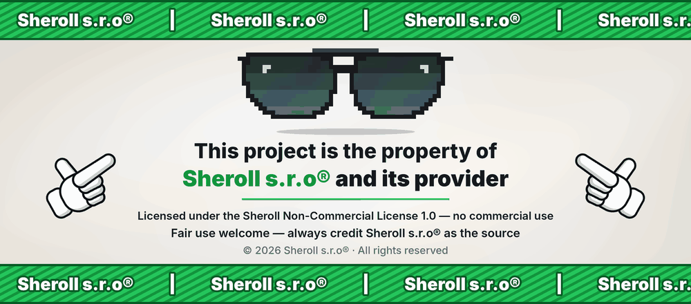

<p align="center"></p>

# Beatuy!SpaceStage

An overhaul of the **space stage** of *Spore*. Your escort takes orders, civilization planets
defend themselves, hold grudges and fight wars of their own, tribes throw spears at your ship, enemy colonies at war
open fire at once under a red sky, and a new colony tool tints a planet's atmosphere in any colour. Everything is built
on the game's own systems: its behaviour trees, relation events, voice lines, effects and interface art.

Current version: **1.0.1**. Download `BeatuySpaceStage.sporemod` from the [Releases](../../releases) page.

## What it changes

### Escort orders

Each ship of your escort (the allies in the **Allies** panel) takes its own order.

- **Opening a ship's drawer.** Click the ship's cube in the Allies panel. The cube glides aside and the ship's
  **order pill** slides out of it, showing the current order. Another click puts it back. The pill uses the panel
  header's own art: blue, lighter under the mouse, yellow while its menu is open.
- **Choosing an order.** Click the pill for the menu of five orders, in the game's tooltip frame.
  - The menu closes on a pick, a second click on the pill, Escape, a click on the world, or the drawer closing.
  - *Protect others…* opens a list of the other escort ships, each with its design picture, plus **All**.
- Ships from **Call for Backup** belong to your own empire. They take no orders and get no pill.

| Order | What the ship does |
| --- | --- |
| **Free** | Vanilla: the game leads the ship. This is every ship's default. |
| **Protect my ship** | Fights only those attacking your ship, and otherwise holds fire. |
| **Protect others** | Fights only those attacking the chosen escort ships, or with **All** every escort ship and yours. While a chosen ship is away, the ship guards yours. |
| **Protect itself** | Fights only those attacking it. |
| **Attack hostiles nearby** | Goes after hostiles, in the order of priority below. |

**Attack hostiles nearby** picks its target in this order:

1. **On a planet, while you attack a city,** the ship joins the attack the way the game leads its escort over the city.
2. **Otherwise, your own target,** if it is hostile. It is taken at once.
3. **Otherwise, the nearest threat** to your ship or to any escort ship: anything aiming at it, the last ship that hit
   it, or anything that shot at it in the last 5 seconds.
4. **Otherwise, the nearest hostile around your ship,** within the reach of the escort ship's weapons. Ships come before
   turrets and vehicles. A ship keeps its target until a new one is more than 30 % nearer, so it does not swing
   between two targets.

**Rules for every order**

- **Only targets that are already hostile.** Since the game counts the escort's damage as yours, an order never starts
  a new fight or a war.
- **Ships that leave the escort** lose their orders and drop out of every guard list. A *Protect others* list left
  empty this way turns into *Protect my ship*.
- **Timing.** Targets are re-chosen four times a second of game time, and the game still steers the weapons every
  frame. Everything waits while the game is paused.

**How the escort fights**

- **On a planet,** an ordered ship goes after its target in the escort's **rose**: the petal-shaped circling the
  game's escort flies over a city you attack.
  - It leaves formation, circles and attacks, and returns when the target, the order or the hostility is gone.
  - Over turrets and ground vehicles the rose is the game's own.
  - Over aircraft and ships it is sized to the escort's anti-air reach and flown just above the target. A ship that
    falls far behind hurries back.
- **In space,** a ship on *Attack hostiles nearby* takes the hostile ship as its leader. The game's formation then
  flies it round that ship, in reach of its weapons.

**Attack marks**

- Each ship on *Attack hostiles nearby* marks its target with the game's own attack reticle, in the colour of the
  ship's empire.
- Two ships on one target stand as rings round your own reticle, so no marks overlap.
- More than two show one white mark.
- The protect orders show no mark.

**Rally Call and voices**

- **The Rally Call** works as usual. In addition, it switches every escort ship except your reinforcements to
  *Attack hostiles nearby*.
- **Spoken replies.** A ship answers a change of order at once, in its own empire's voice, over the radio:
  - *Free* and *Protect itself*: the "joins the escort" line;
  - the protect orders: the Rally Call line;
  - *Attack hostiles nearby*: the "attacking the target" line.

  It never repeats the same line within 3 seconds. Loading a game and ships leaving the escort say nothing.
- **Saved with the game.** The orders are kept in your save (see [Saves](#saves)).

### Civilization planets

On planets in the **City and Civilization** technology levels, the cities and their units now fight for themselves.

**City defence**

- **When you attack a city.** If your ship or escort hits a city's turret, building or city hall, the nearest city of
  that civilization aims every turret at you. Unless it is an economic city, it also calls in up to 6 of its nearest
  fighting units.
- **Sister cities.** A civilization with two or more cities rallies them: sister cities near your ship aim their
  turrets at it and send more units, at most once every 30 seconds.
- **Attacked city halls are remembered** for the session. That city defends itself again whenever you come back.
- **Turrets and units target the nearest of your ship and your escort.**

**How their units fight**

- A called-in unit sets its own orders aside and comes back to them when it is let go.
- Its weapons reach 1.8 times farther while it hunts. It closes in to its weapon's range.
- Ground and sea units give up after 6 seconds without getting closer. Aircraft always chase.
- Military ground and sea vehicles switch to their anti-air weapon against your ship.
- Hits push your ship gently away from the unit, at most twice a second. This replaces the game's push, which could
  drag the ship toward the unit.
- Missionaries' belief beams chase your ship for 4 seconds and hit on contact.
- A unit that is hit fights back at once together with its squad.

**Relations, war and peace**

- **Attacks anger.** Every attack on a civilization's unit applies the game's "attacked" relation event, at half weight,
  whether the unit survives or not.
- **Help is thanked.** Hit a unit that was attacking another civilization, and the defended civilization thanks you.
  It also trusts you for 60 seconds:
  - no suspicion while you linger;
  - its called-in units stand down;
  - its units do not engage you on sight.
- **Lingering is suspicious.** While your ship stays over a city of a civilization that does not like you, its
  standing drops every 8 seconds, and in time it **declares war**.
- **Disliked means engaged on sight.** At a standing of −3 or lower, its units engage your ship on sight, and again
  whenever you come back.
- **War means a hunt.** All of its cities aim at you, and all of its fighting units hunt your ship.
- **Peace.** A civilization at war with you **makes peace** once its standing climbs back to +0.5. It stands down and
  forgets the attacked city halls.

**Common command** (civilizations with two or more cities on the planet)

- **Defence against neighbours.** A neighbour at war raiding its units is met by up to 4 idle fighting units.
- **Offensives.** Every 80 to 120 seconds, it gathers up to 8 idle units from all its cities into one wave against
  the nearest enemy city. Military units attack and missionaries convert.

**Bribes**

- **The offer.** A unit fighting you, hit by your side and left without backup for 2 seconds may offer a bribe of
  250–1000 Sporebucks.
  - The offer appears in the game's event log, with the civilization's bribe sound and the unit's voice line.
  - Click the notification to accept: the money is yours, and the unit stops fighting.
- **Spared units.** A unit you accepted from is spared for the session. It carries a pulsing green ring on the ground,
  and your ship's automatic weapons and your escort hold fire at it.
- **Breaking the deal.** Shoot a spared unit by hand and the deal is broken. **Every empire with a ship in your
  escort** then thinks less of you.

**Superweapons**

- **Which ones.** A civilization uses its own superweapons, and those of its cities' specialties:
  - military: megabomb, technobomb, static bomb;
  - religious: black cloud, invulnerability;
  - economic: propaganda, polite ambassador, madness bomb;
  - its native healing aura.

  The planet-winning superweapons are never fired.
- **How a shot is chosen.** Every possible shot is weighed by what it would meet **where and when it lands**: enemy
  units and turrets, your ship, its own and allied units, its wounded. Only a shot worth enough is fired, and nothing
  is random.
- **Aiming at your ship.** A shot at the ship is aimed where the ship will be when it lands.
- **Safety.** An area bomb is never fired when its blast would reach its own or an allied unit or city.
- **The healing aura** lands among its living wounded within half a second of a wound. It heals only its own units and
  its allies.
- **Pacing.**
  - Nothing fires in the first 15 seconds on the planet.
  - A civilization fires at most once every 45 seconds.
  - The planet sees at most one superweapon every 15 seconds.
- **Against your side,** superweapon hits deal a quarter of their damage. A static bomb also drains 30 % of the ship's
  energy.

**Vehicle designs**

- In vanilla, every civilization vehicle in space is built from one "colony" design per locomotion. With the mod,
  vehicles are built from the culture's own design for their **purpose** (military, religious, economic) and
  **locomotion** (land, sea, air).
- Empty slots are filled from the Sporepedia by the game's own culture pick, in the background, one every 3 seconds.

**Radio**

- You hear the radio chatter of the civilization vehicles nearest your ship, in the game's own unit voice lines:
  engaging, holding, moving, under fire, damage reports and the bribe lines.
- Only the 16 nearest vehicles within range are heard. There is at most one line every half second, and at most one
  per unit every 3 seconds.

### Tribes

A tribe that has spearmen, or a spear rack, sends a few defenders to **stand their ground** against your ship.

- **Throwing.** Defenders throw the game's real tribe spears at your ship and at escort ships, on a ballistic arc,
  with the spear-throw animation. Each spear that strikes deals 20 damage.
- **Between throws,** they take up a new spear, roar and brandish it, or run to a new spot beside or under the
  ship.
- **Spears stick in the hull** where they strike, and ride along with the ship until it leaves the planet.
- **Destroying the spear rack** disarms the tribe: the defenders drop their spears and flee with the village.
- **Who defends.** 40 % of the spearmen, at most 4 per tribe. Without spearmen, adults take spears from the rack.
  Without either, everyone flees as in vanilla.

### Enemy colonies

On planets of spacefaring empires:

- **Turrets open fire at once.** In vanilla, a colony's turrets could leave your ship hovering for about ten seconds
  after a declaration of war. Now every idle turret of an empire at war with you takes your ship as its target within
  half a second.
- **The red sky of war.**
  - On another empire's colony, the atmosphere fades to red while the game's planet capture bar is showing, and for
    5 seconds after reinforcements are called over the planet.
  - When the capture bar first appears, the game's defence squads are called twice, at most once a minute.
  - The red never reaches the save or the planet's picture in the star system.

### Glow Generator

A new **colony tool** that tints a planet's atmosphere: the sky, the haze over the surface and the halo seen from
orbit.

- **The generator.** A crystal vessel that unpacks when placed, with a soft halo, sparks, light ribbons and the
  bio-stabilizer's hum.
- **Colour.** It uses your empire's colour by default. **Double-click the generator** to open the editors' own colour
  palette right over it in the world.
- **Light on models** changes only half way, so creatures, cities and ships keep their own colours.

| | |
| --- | --- |
| Store | 5,000 Sporebucks, sold by Bard, Scientist and Shaman empires |
| Tool | In the Colonization palette, after the uber turret. Range 300 |
| Where | Your colonies and unclaimed planets. One per planet |
| Not on | Planets of tribes, cities or civilizations, other empires' colonies, and any planet of a star system another empire owns. The game's own "This planet is already claimed." message is shown and nothing is spent |
| Health | 1000. A destroyed generator's glow fades away |
| Palette | Opens within 200 of your ship, only for your own generators |
| Saves | The colour is kept in the save, and the tinted atmosphere is shown in the star system view |

**Alien generators.** Scientist, Shaman and Bard empires keep generators on 60 % of their colonies, some in colours of
their own. The choice is fixed for each colony. An alien generator belongs to the colony's owner: it wears the owner's
colour on the planet, on its rollover and on the minimap, and an attack on it angers the owner as an attack on the colony
does.

### Travel and escort safety

- **Double-click travel.** Double-click a star in the galaxy or a planet in a star system. The ship flies there, and on
  arrival the camera zooms in by itself, with no mouse wheel needed.
- **Quick exit.** **Shift + Space**, or **Shift + mouse wheel out**:
  - on a planet, the ship climbs straight out to the star system;
  - in a star system, the view zooms out to the galaxy.

  Each quick exit costs 5 % of the ship's maximum energy, with a 1.5-second cooldown.
- **Your weapons no longer lock on or fire at your escort.**
- **The area repair skips ships that have left your escort.** Such a ship stays near you as its empire's defender. It
  is no longer healed, so its thanks no longer fill the radio.

## What it does not change

- **Nothing outside the space stage.** In other stages every hook passes straight through.
- **An escort on *Free*** behaves exactly as in vanilla. In space, formation and flight stay the game's.
- **No new fights.** Orders never make the escort open fire on anything that is not already hostile.
- **Planet data.** No planet's atmosphere type, gradient or terrain is changed. Both glows are applied as the frame is
  drawn.
- **No new Sporepedia content.** The vehicle designs come from the game's own culture pick.
- **Weapon and damage numbers** stay the game's, except as described above:
  - superweapon hits on your side;
  - the static bomb's energy drain;
  - the reach of called-in units;
  - spears and belief beams.
- **No new interface layouts.** The drawer, the menu and the palette are built from the game's own interface pieces
  and art.

## Languages

All texts of the mod follow the game's language, in all 23 languages Spore ships. These texts are the order
captions, menus and tooltips, the bribe offer, and the Glow Generator's name and description. The wording follows the
game's own terms: the escort is "allies", refusals reuse the game's own text, and money is in the localized
"Sporebucks".

## Installation

1. Install the [Spore ModAPI Launcher Kit](https://davoonline.com/sporemodder/rob55rod/ModAPI/Public/index.html)
   if you do not have it yet.
2. Open `BeatuySpaceStage.sporemod` with **Spore ModAPI Easy Installer**.
3. Start the game with **Spore ModAPI Launcher**. If the game was already running, restart it completely.

**Manual installation.** Copy the two separate release files by hand. They are identical to the ones inside the
installer:
- `BeatuySpaceStage.dll` into `Spore ModAPI Launcher Kit/mLibs/`;
- `BeatuySpaceStage.package` into `SPORE Galactic Adventures/Data/`.

**Removing the mod.** Use **Spore ModAPI Easy Uninstaller → Beatuy!SpaceStage**, or delete both files.
- A game without the mod skips the saved escort orders and loads the save normally.
- Glow Generators placed in a save need the mod's package. Removing the mod from a campaign that has them has not been
  tested.

## Compatibility

**The game build.** The mod checks the game before it changes anything.
- It runs only on the game's `SporeApp_ModAPIFix.exe` dated 30 September 2024 (PE timestamp `1727737552`, image
  size 26,271,744 bytes). That executable carries the Galactic Adventures "march2017" code, which the Launcher starts.
- It then compares the first bytes of the game functions it calls and of the game data and code it reads or patches
  with the bytes it expects there.
- Hooks are checked as they are placed. A function must start with the game's own bytes or with another mod's
  detour, and a virtual-table slot must hold the game's function or another mod's code.
- If the game is a different build, or another mod changed the same places in an unexpected way:
  - the mod changes nothing, and the game runs as vanilla;
  - a message box says that this version of Spore is not supported.

**Other mods.**
- Mods that hook the same game functions work alongside it.
  - If another mod's detour is already at the start of a function, Beatuy!SpaceStage calls through it, so both run.
  - If another mod already holds a virtual-table slot, the mod chains behind it.
- If some hooks still cannot be placed, the mod runs with the rest and says so in a message box.
- If another mod already holds the save slots of the player's ship record, the escort orders are not saved, and the
  game's own saving is untouched.

**Package conflicts.** The package carries copies of two of the game's lists, with the Glow Generator added:
`spacetools~/ToolConfig` and `spacetoolpalette~/ColonizePalette`. A mod that replaces the same files conflicts with it,
and the load order decides which list wins.

## Saves

| What | Where |
| --- | --- |
| Escort orders | An extra attribute `beatuyEscortOrders` in the game's own record of your ship and escort |
| Glow Generators and their colours | The game's own planet records, as colony objects |
| Relations, wars and peace | The game's own relation system, changed through its own events |
| Bribe money | Your empire's money |

- **Escort orders.**
  - Only ships still in the escort are written, up to 16.
  - Saves made without the mod load with every ship on *Free*.
  - Orders saved for a different player empire are dropped.
- **Kept only for the session:** spared units, remembered city-hall attacks, ongoing hunts and disarmed tribes.

## How it works

The DLL is loaded by the Spore ModAPI Launcher Kit, but contains no Spore ModAPI code. It finds `SporeModAPI.dll`,
registers a post-init callback, and starts once the game is up.

- **The map of the game.** Every address the mod uses is listed in one map (`src/game/map`), 193 entries in all.
  127 of them carry the bytes expected there, and those bytes are checked at start-up or when the hook is placed.
- **Hooks.** The mod places 42 hooks: 24 virtual-table slots and 18 code detours (Microsoft Detours). It also makes
  three byte-level changes:
  - one 4-byte jump patch and one behaviour-record swap let the escort's rose take the mod's targets;
  - one redirected call gives a tool object's rollover its owner's colour.
- **Features.** Each feature is a module run once per frame in a fixed order, after the space game mode's own update.

| Game system | Hooks |
| --- | --- |
| Space game mode | Update, Exit and MouseDown slots; the system and planet cameras' mouse wheel |
| Ship | Combatant TakeDamage, AddHostileUnit, IsInRange and SetTarget slots; the set-target-in-range-band call of the behaviour trees |
| Space simulation | The space game simulator's Update; the player ship record's Write and Read |
| Tools | The tool target check; FireTool; the place-object tool's Update; the area repair's and the Rally Call's WhileFiring; a placed tool object's minimap mark and model view; the tool object rollover's colour (a redirected call) |
| Combat and flow | Base combatant TakeDamage; leaving the planet; the player ship destroyed; the reinforcement call |
| Civilization | Relationship apply; vehicle AddOrder and AddOrderAt; vehicle combatant slots; city vehicle spawn; belief projectile update and launch; the voice queue |
| Tribe | Spear projectile update; the panic and cower behaviour ticks |
| Planet rendering | Atmosphere colour and the light on models (`cTerrainStateMgr`); the star-system picture bake |
| Localization | The locale table text lookup |
| Escort rose | The rose's escort gate (one `je` redirected); the escort's behaviour node 3 gets the mod's copy of its record |

**Escort orders**

- Targets pass through the ship combatant's `SetTarget` slot. Every ship's target goes through untouched, except an
  ordered escort ship's.
- On a planet, the order's target becomes the ship's AI target through the game's own setter, and the escort's rose
  flies it.
- In space, the ship's follow-leader field is set the way the game sets it.
- The drawer is built from UTFWin windows inside the Allies panel's own layout. It borrows the panel's art by
  reference.
- The marks are Swarm effects placed through the game's own reticle routine.

**Atmosphere.** The game works out the atmosphere colour every frame. The mod changes it right after, and the light on
models right after that. Nothing stored in the planet changes, so the colour returns the moment the mod stops.

**Texts.** The game takes a locale table from the first package that has one, whatever its language. The mod therefore
answers its own texts through the hooked locale lookup, in the game's language.

## Building from source (Linux)

> **A note from the author:** this release was built and tested on Linux, and the instructions below are for Linux.
> The mod can also be built on other systems, such as Windows or macOS, if you know how to set up a clang++ build of a
> 32-bit Windows DLL with C++20 modules there. Such builds are not covered here.
> To play the mod, you don't need to build anything: just use the `.sporemod` from Releases.

The mod is a 32-bit Windows DLL written with C++20 modules and cross-compiled with clang++ for the MSVC ABI.

**Tested with:**
- LLVM 21.1.8:
  - `clang++` and `clang-scan-deps`;
  - `lld`, `llvm-ar`, `llvm-ranlib`, `llvm-mt`, `llvm-rc` and `llvm-objdump`.
- CMake 4.3.4 (3.28 or newer is required) and Ninja 1.13.2 (C++20 modules build only with Ninja).
- GNU `bash` 4.4 or newer, coreutils, findutils and grep, plus `git`, `curl` and `tar`.
- clang-format 21, only for `cmake/format.sh`.

Like every file of the project, each script starts with an empty line (see
[Formatting and the layout guard](#formatting-and-the-layout-guard)). The scripts therefore have no shebang line and
are run with `bash`.

### Build

```sh
git clone https://github.com/codestlover/Spore-BeatuySpaceStage.git && cd Spore-BeatuySpaceStage
cmake -S . -B build -G Ninja -DCMAKE_BUILD_TYPE=Release \
    -DCMAKE_TOOLCHAIN_FILE=cmake/toolchain-clang-i686.cmake -DCIV_ACCEPT_MSVC_LICENSE=ON
cmake --build build
```

This produces `build/bin/BeatuySpaceStage.dll`.
- The build compiles one file at a time.
- After linking, `cmake/imports.sh` fails the build if the DLL imports anything other than `KERNEL32`, `USER32`,
  `VCRUNTIME140` and the universal CRT.
- The build is reproducible. With the tools listed above, a build from a fresh clone in another folder gives a DLL
  byte-identical to the one in the release.

The package cannot be rebuilt from this repository. Its sources are made from the game's own data, which cannot be
redistributed. Use the `BeatuySpaceStage.package` from the release.

### Dependencies

The first `cmake` run runs `cmake/setup.sh`, which downloads everything the build needs into `deps/` (git ignores
`deps/`):

- `deps/Detours`: [Microsoft Detours](https://github.com/microsoft/Detours) at tag `v4.0.1`, checked by commit hash.
- `deps/msvc-sdk`: the MSVC CRT 14.44 and Windows SDK 10.0.26100 for x86, downloaded with
  [xwin](https://github.com/Jake-Shadle/xwin) 0.10.0.
  - If `xwin` 0.10.0 is not in `PATH`, the script downloads that release into `deps/.xwin`.
  - It checks the release by SHA-256 (x86_64 and aarch64 Linux).

**The Microsoft license.** The MSVC CRT and Windows SDK come under the Microsoft license and are not redistributed.
- `-DCIV_ACCEPT_MSVC_LICENSE=ON` means you accept that license. Without it, the first `cmake` run stops and explains
  the choice.
- If you already have an xwin "splat" tree, pass `-DCIV_MSVC_SDK=/path/to/tree` instead. Keep it outside the
  repository.

**Keeping the dependencies elsewhere.** Pass `-DCIV_DEPS=/some/dir`, or set `CIV_DEPS` in the environment, before the
first `cmake` run.
- It must be an absolute path to a folder used only for these dependencies.
- To change `CIV_DEPS` or `CIV_MSVC_SDK` later, configure a new build folder.
- `deps/` needs about 1 GB. xwin's download cache is removed once the SDK is unpacked.

**Later runs** reuse `deps/`. `setup.sh` records its own checksum in `deps/.setup-stamp`. When the script changes, the
next `cmake` run prepares the dependencies again.

**Running the script by hand:** `bash cmake/setup.sh --accept-msvc-license`.
- It also accepts `--xwin PATH`, `--xwin-cache PATH` and `--msvc-sdk PATH`.
- It reads `CIV_DEPS` from the environment.

### Testing and releases

Each release is checked in two ways:
- the bytes the mod's map of the game expects are checked against the game executable;
- the mod is played in the game.

These tools, the package sources and the release scripts work on the game's own code and data, which cannot be
redistributed. So they are not part of this repository, and the `.sporemod` is only published on the
[Releases](../../releases) page.

## Project layout

| Path | Contents |
| --- | --- |
| `src/core` | Entry point, hooks, the order in which features run, the game's language |
| `src/game/map` | The map of the game: every address the mod uses, with the bytes expected there |
| `src/game/objects` | Typed views over the game's objects: ships, vehicles, cities, empires, planets, the interface |
| `src/game` | Memory access, maths and world queries shared by the features |
| `src/space/orders` | Escort orders: the drawer, behaviour, marks, replies, saving and their texts |
| `src/space/civilization` | Civilization planets: defence, relations, common command, bribes, superweapons, designs |
| `src/space/radio` | The civilization radio |
| `src/space/tribe` | Tribal defence and spears |
| `src/space/colony` | Enemy colony turrets |
| `src/space/glow` | The red sky of war and the atmosphere tint |
| `src/space/generator` | The Glow Generator: its placement, palette and texts |
| `src/space/travel`, `src/space/exit` | Double-click travel and the quick exit |
| `src/space/escort` | The fire guard and the area repair |
| `cmake` | The clang++ cross toolchain and the scripts `setup.sh`, `layout.sh`, `imports.sh`, `format.sh` |

### Formatting and the layout guard

```sh
bash cmake/format.sh
```

This formats the C++ sources with clang-format 21 and fixes the framing of the files. To use a specific clang-format
binary, set `CLANG_FORMAT=/path/to/clang-format`.

The build also enforces the project layout with `cmake/layout.sh`. It checks every file of the project tree except
the build and dependency folders:

- Every text file starts with exactly one empty line and ends with exactly two.
- C++ headers use `.hpp`.
- `src/` keeps its files in subdirectories.

CMake runs this check at configure time and before every build. Any violation stops the build with a list of files.
`bash cmake/layout.sh --fix` fixes the framing. The first rule is also why the scripts have no shebang: `#!` only
works on the very first line of a file.

## Credits and license

© 2026 Sheroll s.r.o® All rights reserved.

Beatuy!SpaceStage is licensed under the **Sheroll Non-Commercial License 1.0** (see [`LICENSE`](LICENSE) and
[`licenses/Sheroll-NC-1.0.md`](licenses/Sheroll-NC-1.0.md)). The license text decides. In short:

- You may play Spore with the mod.
- You may read, change and rewrite its code.
- You may use its code and resources in your own works and share them free of charge. Name the source as
  **"Based on Beatuy!SpaceStage by Sheroll s.r.o®"** in their credits and wherever they are published.
- Fair use stays free.
- **No commercial use** of any kind.
- Sharing unchanged copies of the whole mod needs Sheroll's permission. Link to this page instead.

Material of others:

- [Microsoft Detours](https://github.com/microsoft/Detours), MIT, fetched by `cmake/setup.sh` and linked into the DLL.
- Spore and Galactic Adventures belong to Electronic Arts/Maxis. The mod is not made, approved or supported by
  Electronic Arts.
  - This repository contains no game executables, game assets, save data or decompiled game code.
  - The released package contains some files made from the game's own data: the Glow Generator's textures and model
    layout, the game's tool lists that it extends, the escort's rally voice lines and the recoloured attack reticle.

Full notices are in [`NOTICE.md`](NOTICE.md) and [`licenses/`](licenses).

